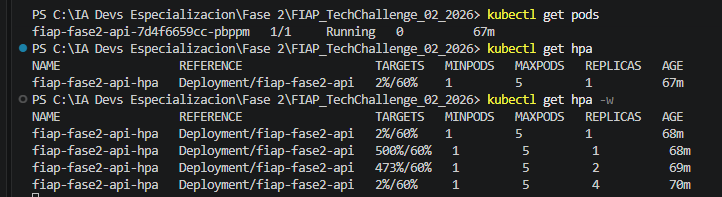
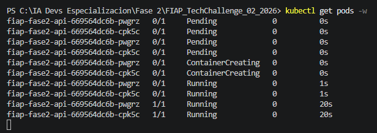
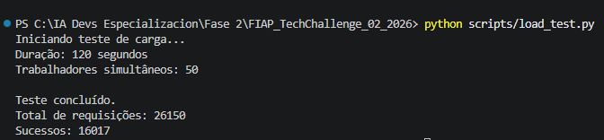

# 🧬 FIAP Tech Challenge — Fase 2: Ecossistema Integrado de Triagem Oncológica

**Projeto 1 — Otimização de Modelos de Diagnóstico Oncológico via Algoritmos Genéticos e IA Generativa (LLMs)**

> **Integrantes (Grupo 40):** Felipe Antonio Ayancan Hernandez & Fernando Ponz Vargas
> **Vídeo de demonstração:** [Inserir link do YouTube/Vimeo]
> **Documentação de arquitetura e evidências K8s:** [`docs/arquitetura.md`](docs/arquitetura.md)
> **Relatório formal de entrega:** [`Relatorio_Entrega_Fase2.docx`](Relatorio_Entrega_Fase2.docx)

> ⚠️ Projeto acadêmico. Nenhum resultado deve ser usado como diagnóstico médico ou substituir a avaliação de um profissional de saúde.

---

## 🎯 Visão geral

Este repositório integra **Machine Learning otimizado por Algoritmos Genéticos**, **explicabilidade (SHAP)**, **IA generativa (LLM)**, **API REST com observabilidade**, **escalabilidade automática com Kubernetes (HPA)** e uma **interface clínica interativa em Streamlit**.

O grupo explorou **duas estratégias complementares de Algoritmo Genético** sobre o mesmo dataset e a mesma divisão treino/teste:

|                       | 🅰️ Abordagem A — AG de hiperparâmetros                                                                     | 🅱️ Abordagem B — AG com threshold como gene                                  |
| --------------------- | ---------------------------------------------------------------------------------------------------------- | ---------------------------------------------------------------------------- |
| Implementação         | Própria, em Python puro ([`notebooks/02_algoritmo_genetico.ipynb`](notebooks/02_algoritmo_genetico.ipynb)) | Biblioteca **DEAP** ([`src/genetic_optimizer.py`](src/genetic_optimizer.py)) |
| Genes                 | `C`, `class_weight`, par `solver/penalty`                                                                  | `C` (contínuo), `class_weight`, **threshold**                                |
| Threshold             | Escolhido depois, por F2-score em validação cruzada                                                        | Otimizado junto com os hiperparâmetros                                       |
| Fitness (CV, 5 folds) | 0,50 × Recall + 0,30 × F1 + 0,20 × ROC-AUC                                                                 | 0,80 × Recall + 0,20 × F1                                                    |
| Modelo final          | `C = 0,1`, `balanced`, `liblinear/l2`, threshold 0,34                                                      | `C = 0,9307`, `None`, `lbfgs`, threshold 0,1815                              |
| Artefato              | `models/modelo_ga_fase2.joblib`                                                                            | `data/best_model_phase2.joblib`                                              |
| Usado por             | **API REST, Kubernetes e testes**                                                                          | **Interface Streamlit (`app.py`)**                                           |

```text
                         ┌───────────────────────────┐
                         │   Médico / Especialista   │
                         └─────────────┬─────────────┘
                                       │
              ┌────────────────────────┴────────────────────────┐
              ▼                                                 ▼
┌─────────────────────────────┐                 ┌─────────────────────────────┐
│  Interface Clínica          │                 │  Sistemas externos          │
│  Streamlit (app.py · 8501)  │                 │  (HTTP / REST)              │
│  Modelo 🅱️ (DEAP)            │                 └──────────────┬──────────────┘
│  + llm_explainer.py         │                                │
└─────────────────────────────┘                                ▼
                                               ┌─────────────────────────────┐
                                               │  API FastAPI (8000)         │
                                               │  /predict  /interpret       │
                                               │  /features /health /metrics │
                                               └──────────────┬──────────────┘
                                                              │
                              ┌───────────────────────────────┼───────────────────────────────┐
                              ▼                               ▼                               ▼
                    ┌───────────────────┐           ┌───────────────────┐           ┌───────────────────┐
                    │ Modelo 🅰️ (AG     │           │ SHAP              │           │ LLM               │
                    │ próprio, C = 0,1) │           │ LinearExplainer   │           │ prompt v2 +       │
                    │ threshold 0,34    │           │ (5 fatores)       │           │ fallback          │
                    └───────────────────┘           └───────────────────┘           └───────────────────┘

Pods da API ──▶ Metrics Server ──▶ HPA ──▶ 1 a 5 réplicas  (independente do /metrics)
```

Em ambos os caminhos, **a classificação é feita pelo modelo de Machine Learning**; a LLM apenas interpreta o resultado.

---

## 📊 Resultados principais (conjunto de teste: 114 casos, 42 malignos)

### 🅰️ Abordagem A — comparação com o modelo final da Fase 1 (threshold 0,50)

| Indicador            | Fase 1 (GridSearchCV, `C = 1`) | Fase 2 (AG próprio, `C = 0,1`) | Impacto clínico                                                         |
| :------------------- | :----------------------------: | :----------------------------: | :---------------------------------------------------------------------- |
| **Acurácia**         |             0,9737             |           **0,9912**           | Menos erros no total                                                    |
| **Precisão**         |             0,9756             |           **1,0000**           | Nenhuma paciente benigna classificada como maligna (com threshold 0,50) |
| **Recall (maligno)** |             0,9524             |           **0,9762**           | 41 dos 42 casos malignos identificados                                  |
| **F1-score**         |             0,9639             |           **0,9880**           | Melhor equilíbrio entre precisão e recall                               |
| **ROC-AUC**          |             0,9954             |           **0,9977**           | Melhor separação entre as classes                                       |
| **Falsos negativos** |               2                |             **1**              | **Redução de 50%** dos casos malignos não detectados                    |
| **Falsos positivos** |               1                |             **0**              | Nenhum exame adicional desnecessário                                    |

Com o threshold de **0,34** adotado pela API, o modelo mantém 1 falso negativo e passa a ter 5 falsos positivos (Precisão 0,8913).

### 🅱️ Abordagem B — comparação com a Regressão Logística original da Fase 1 (sem otimização)

| Indicador        | Fase 1 original (`C = 1`, `None`, T = 0,50) | Fase 2 DEAP (`C = 0,9307`, T = 0,1815) |
| :--------------- | :-----------------------------------------: | :------------------------------------: |
| Recall (maligno) |                   92,86%                    |               **97,62%**               |
| Precisão         |                   97,50%                    |                 91,11%                 |
| F1-score         |                   95,12%                    |                 94,25%                 |
| Acurácia         |                   96,49%                    |                 95,61%                 |
| Falsos negativos |                      3                      |                 **1**                  |
| Falsos positivos |                      1                      |                   4                    |

A Abordagem B prioriza a sensibilidade (80% do fitness é Recall): reduz os falsos negativos de 3 para 1, ao custo de mais falsos positivos.

### 🧪 Os 3 experimentos de cada abordagem

| 🅰️ Experimento             | População | Gerações | Mutação | Elitismo | Fitness CV | Ótimo na geração |
| -------------------------- | :-------: | :------: | :-----: | :------: | :--------: | :--------------: |
| 1 — Conservador (vencedor) |    20     |    15    |  0,05   |    2     |   0,9686   |        4         |
| 2 — Intermediário          |    30     |    20    |  0,10   |    2     |   0,9686   |        1         |
| 3 — Exploração ampla       |    40     |    25    |  0,20   |    4     |   0,9686   |        1         |

| 🅱️ Experimento (DEAP)          | População | Gerações | Crossover | Mutação | Fitness CV |   C    | Threshold |
| ------------------------------ | :-------: | :------: | :-------: | :-----: | :--------: | :----: | :-------: |
| 1 — Conservador                |    20     |    10    |    0,5    |   0,2   |   0,9757   | 4,3179 |  0,1677   |
| 2 — Alta exploração (vencedor) |    35     |    15    |    0,7    |   0,4   | **0,9804** | 0,9307 |  0,1815   |
| 3 — População expandida        |    50     |    20    |    0,6    |  0,25   |   0,9767   | 1,9221 |  0,2932   |

---

## 🎚️ Threshold e o feedback da Fase 1

Na avaliação da Fase 1 (nota 90/90), o professor recomendou **reduzir o threshold de 0,50 para 0,30** e verificar se os falsos negativos zeravam. As duas abordagens responderam a isso:

- **🅰️** escolheu o threshold com probabilidades _out-of-fold_ no treino (maior F2-score → **0,34**), sem usar o teste. A recomendação de 0,30 foi testada nos dois modelos ([`notebooks/03`](notebooks/03_threshold_e_explicabilidade.ipynb)): com 0,30, o modelo da Fase 1 continua com 2 falsos negativos e o otimizado com 1. **A redução de falsos negativos veio do Algoritmo Genético, e não do threshold.**
- **🅱️** levou a recomendação adiante tratando o threshold como um **gene**, otimizado junto com os hiperparâmetros. O AG convergiu para limiares abaixo de 0,30 (0,17 a 0,29).

Nas duas abordagens resta **1 falso negativo**: um tumor maligno com textura baixa (percentil ~21), atípico para o modelo.

---

## 🔍 Explicabilidade (SHAP)

- `LinearExplainer` com o treino padronizado como referência; valores em **log-odds** (positivos aumentam e negativos reduzem a tendência para malignidade).
- 8 das 10 variáveis mais importantes coincidem entre o modelo da Fase 1 e o otimizado (Spearman 0,70).
- A interface Streamlit usa a contribuição linear (coeficiente × valor padronizado), equivalente ao SHAP de um modelo linear com features centralizadas.
- O SHAP descreve o comportamento do modelo, **não causalidade clínica**.

---

## 🤖 Integração com LLM

| Módulo                                         | Usado por           | Abordagem                                                                                                                                  |
| ---------------------------------------------- | ------------------- | ------------------------------------------------------------------------------------------------------------------------------------------ |
| [`src/llm_service.py`](src/llm_service.py)     | API (`/interpret`)  | Prompt v2 com zona de incerteza, percentis e pontos de atenção; timeout, retries e fallback (responde com predição + SHAP se a LLM falhar) |
| [`src/llm_explainer.py`](src/llm_explainer.py) | Interface Streamlit | Laudo estruturado via GPT-4o-mini, com gerador determinístico de contingência quando não há chave da API                                   |

### Avaliação da qualidade (prompt da API, 4 casos)

Casos: alta probabilidade, próximo ao threshold (falso positivo), baixa probabilidade e falso negativo. Três métodos: **manual**, **automático** (verificações objetivas) e **LLM-as-a-judge**.

| Versão | Score automático | Fidelidade |  Clareza | Segurança | Completude | Acionabilidade | Média do juiz |
| ------ | ---------------: | ---------: | -------: | --------: | ---------: | -------------: | ------------: |
| v1     |             0,97 |   **5,00** |     4,25 |      5,00 |   **5,00** |           2,25 |      **4,30** |
| v2     |         **1,00** |       2,50 | **4,50** |      5,00 |       4,75 |       **3,25** |          4,00 |

- A v2 acertou todas as verificações automáticas e foi a única a sinalizar a **zona de incerteza** no falso positivo.
- A queda de fidelidade da v2 no juiz é um viés do avaliador: ele não recebeu o mesmo contexto da v2 e penalizou informações corretas.

Detalhes em [`notebooks/04_llm.ipynb`](notebooks/04_llm.ipynb) e [`docs/arquitetura.md`](docs/arquitetura.md).

---

## 🖥️ Interface clínica (Streamlit)

[`app.py`](app.py) permite ao profissional de saúde simular casos em tempo real:

- 6 controles para os biomarcadores principais (raio, textura, perímetro, área, concavidade e pontos côncavos médios); as demais variáveis usam a média do dataset;
- probabilidade, threshold clínico e classificação de risco;
- 4 principais contribuições (SHAP linear);
- interpretação gerada por `llm_explainer.py`.

A interface usa o **modelo 🅱️** (`data/best_model_phase2.joblib`) diretamente, sem passar pela API.

---

## 📂 Estrutura do projeto

```text
FIAP_TechChallenge_02_2026/
├── api/main.py                     # API FastAPI: endpoints, logging e métricas Prometheus
├── app.py                          # 🅱️ Interface clínica em Streamlit
├── src/
│   ├── prediction_service.py       # 🅰️ predição (modelo e threshold da API)
│   ├── explainability_service.py   # 🅰️ SHAP LinearExplainer
│   ├── llm_service.py              # 🅰️ LLM da API (prompt v2, timeout, fallback)
│   ├── logging_config.py
│   ├── genetic_optimizer.py        # 🅱️ AG com DEAP (3 experimentos)
│   ├── model_trainer.py            # 🅱️ dados e pipelines
│   └── llm_explainer.py            # 🅱️ laudo da interface (GPT-4o-mini + contingência)
├── notebooks/
│   ├── 01_baseline_fase1.ipynb              # reproduz o modelo final da Fase 1
│   ├── 02_algoritmo_genetico.ipynb          # 🅰️ AG próprio: genes, operadores, 3 experimentos
│   ├── 03_threshold_e_explicabilidade.ipynb # threshold, recomendação 0,30, SHAP
│   └── 04_llm.ipynb                         # LLM: prompt v1 × v2 e avaliação
├── tech_challenge_fase2.ipynb      # 🅱️ notebook didático da abordagem DEAP
├── models/modelo_ga_fase2.joblib   # 🅰️ modelo servido pela API
├── data/
│   ├── data.csv                    # Breast Cancer Wisconsin Diagnostic
│   ├── best_model_phase2.joblib    # 🅱️ modelo da interface
│   └── experiments_results.joblib  # 🅱️ resultados dos experimentos DEAP
├── results/                        # métricas, gráficos e avaliações dos notebooks
├── tests/                          # 15 testes automatizados (pytest)
├── scripts/                        # testes manuais e teste de carga
├── k8s/                            # Deployment, Service, HPA, Secret (exemplo), patch do Metrics Server
├── docs/                           # arquitetura.md e evidências do autoscaling
├── generate_nb.py · generate_report.py  # geração do notebook didático e do relatório
├── railway.json                    # configuração opcional de deploy no Railway
├── Dockerfile · docker-compose.yml
├── projeto.bat                     # menu de execução no Windows (duplo clique)
└── requirements.txt
```

---

## 🚀 Como executar

### 1. Configuração

```powershell
Copy-Item .env.example .env      # Windows
```

```bash
cp .env.example .env             # Linux/macOS
```

```env
OPENAI_API_KEY=sua_chave
LLM_MODEL=seu_modelo
```

Sem `OPENAI_API_KEY`, a API inicia normalmente (`/interpret` responde sem a explicação da LLM) e a interface usa o gerador de contingência.

### 2. Menu com um clique (Windows)

Execute **`projeto.bat`** (duplo clique):

```text
 PROJETO                                KUBERNETES
  [1] Iniciar projeto (API + Jupyter)    [5] Implantar no Kubernetes (HPA)
  [2] Encerrar projeto                   [6] Executar teste de carga (autoscaling)
  [3] Verificar status                   [7] Remover do Kubernetes
  [4] Executar testes automatizados
```

### 3. Docker Compose (manual)

```bash
docker compose up -d --build
```

| Serviço           | Endereço                   |
| ----------------- | -------------------------- |
| API (Swagger)     | http://localhost:8000/docs |
| Jupyter           | http://localhost:8888      |
| API no Kubernetes | http://localhost:8010/docs |

Execute os notebooks na ordem `01 → 02 → 03 → 04`.

### 4. Interface clínica

```bash
streamlit run app.py
```

Acesse http://localhost:8501.

### 5. Abordagem B (DEAP)

```bash
python -m src.genetic_optimizer
```

Gera `data/best_model_phase2.joblib` e `data/experiments_results.joblib`, usados pela interface e por `tech_challenge_fase2.ipynb`.

### 6. Sem Docker (ambiente virtual)

```bash
python -m venv .venv
.venv\Scripts\activate           # Windows  (Linux/macOS: source .venv/bin/activate)
pip install -r requirements.txt
uvicorn api.main:app --reload
```

### 7. Testes

```bash
docker compose exec api python -m pytest tests/ -v
```

**15 testes aprovados**: API, predição, SHAP, `/interpret` com LLM simulada e indisponível, validação de entrada e `/metrics`. A LLM é simulada com `mock`, sem consumir créditos.

---

## 🌐 API

| Método | Rota         | Descrição                                       |
| ------ | ------------ | ----------------------------------------------- |
| GET    | `/health`    | Health check (usado pelas probes do Kubernetes) |
| GET    | `/features`  | As 30 variáveis esperadas                       |
| POST   | `/predict`   | Probabilidade, threshold e classificação        |
| POST   | `/interpret` | Predição + 5 fatores SHAP + explicação da LLM   |
| GET    | `/metrics`   | Métricas em formato compatível com Prometheus   |

No Swagger, `/predict` e `/interpret` já trazem um paciente de exemplo.

---

## ☸️ Kubernetes e escalabilidade automática

```bash
docker build -t fiap-fase2-api:latest .
kubectl create secret generic fiap-fase2-secrets --from-env-file=.env
kubectl apply -f k8s/deployment.yaml -f k8s/service.yaml -f k8s/hpa.yaml
```

- **HPA:** 1 a 5 réplicas, meta de 60% de CPU (sobre `requests` de 100m).
- **Porta:** a API no Kubernetes fica em `localhost:8010`, e o docker compose continua na `8000`.
- **Metrics Server:** no Docker Desktop exige `--kubelet-insecure-tls` (`k8s/metrics-server-patch.yaml`, somente ambiente local).
- **Teste de carga** (`scripts/load_test.py`, 50 workers, 120 s, `POST /predict`): 26.150 requisições, 16.017 com sucesso (61,3%). Antes do ajuste do `timeoutSeconds` das probes, a taxa era de 38%. É um teste de estresse para validar o HPA, não um benchmark.

### Evidências

**HPA aumentando réplicas (1 → 2 → 4):**



**Criação automática de pods:**



**Resultado do teste de carga:**



---

## 🔒 Segurança

- `.env` e `k8s/secret.yaml` não são versionados; apenas `.env.example` e `k8s/secret.example.yaml`.
- O log da API não registra a chave da OpenAI nem as variáveis clínicas da paciente.

---

## ⚠️ Limitações

- Dataset público, sem validação clínica; o conjunto de teste é pequeno (114 casos).
- As abordagens A e B produzem modelos diferentes: a API e a interface ainda não usam o mesmo modelo.
- O texto gerado pela LLM é uma interpretação de apoio, não um laudo médico; a conduta final é sempre do profissional de saúde.
- Kubernetes executado localmente (Docker Desktop); `railway.json` é uma configuração opcional, não utilizada nas evidências.
- A avaliação da LLM utiliza poucos casos.

Detalhes, decisões de implementação, desafios e evoluções futuras: [`docs/arquitetura.md`](docs/arquitetura.md).
